<div align="center" dir="rtl">

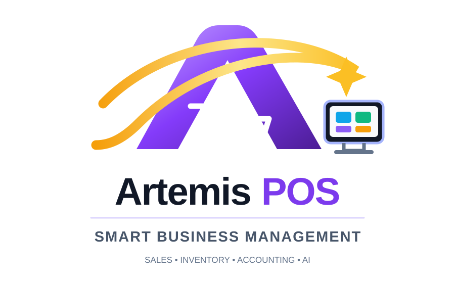

# آرتميس | Artemis ERP
### إدارة المتجر · نقاط البيع · ذكاء الأعمال

**منصة حديثة لإدارة المتاجر ونقاط البيع، تدعم العمل دون اتصال والمزامنة الفورية عبر Supabase ومساعدًا ذكيًا متصلًا ببيانات الأعمال.**

<p>
  
  
  
</p>
<p>
  
  
  
  
  
</p>

**نقاط البيع · المخزون · المرتجعات · المحاسبة · توقع المبيعات · المساعد الذكي**

🌐 **[English](README.md) · [فارسی](README.fa.md) · [Deutsch](README.de.md) · [العربية](README.ar.md)**

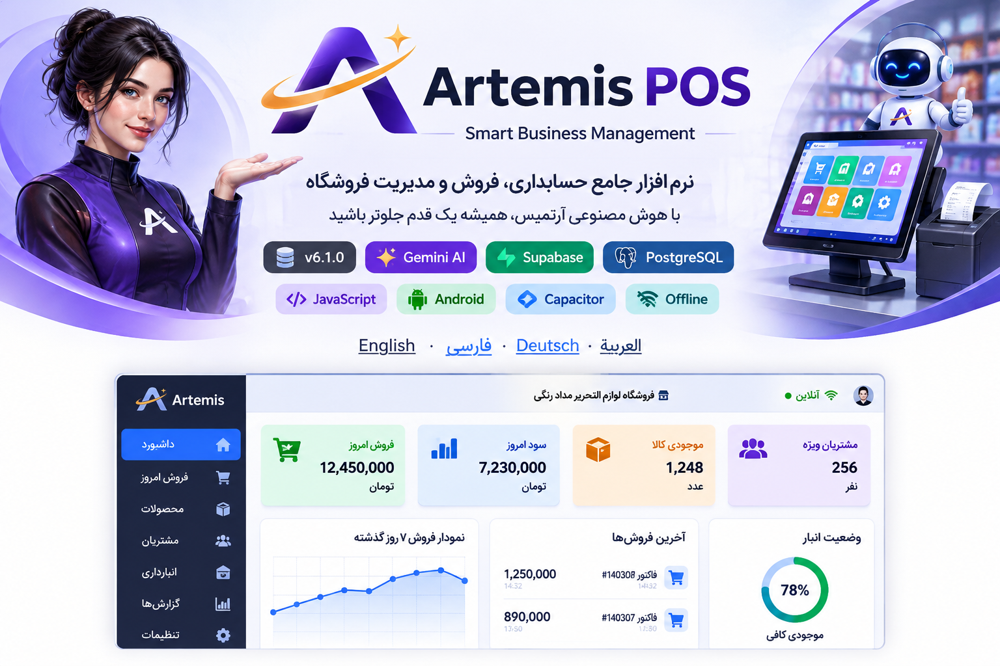

</div>

<div dir="rtl">

**نظرة سريعة:**
- نظام POS/ERP متكامل للتجزئة (مبيعات، مخزون، مرتجعات، محاسبة، طباعة) — بالإضافة إلى مساعد ذكاء اصطناعي متصل بقاعدة البيانات وتوقع مبيعات قائم على قواعد استدلالية، وليس مجرد عمليات CRUD.
- مُستضاف ذاتيًا على مشروع Supabase خاص بك (Postgres + Auth + Realtime + Edge Functions)؛ يعمل كتطبيق ويب وكتطبيق أندرويد أصلي عبر Capacitor.
- تم بناؤه وتطويره على مدى عامين من الاستخدام الفعلي اليومي في متجر حقيقي — وليس مشروعًا تعليميًا.

---

**المحتويات**

- [نظرة عامة](#نظرة-عامة)
- [لماذا آرتميس؟](#لماذا-آرتميس)
- [الميزات الأساسية](#الميزات-الأساسية)
- [المساعد الذكي لإدارة الأعمال](#المساعد-الذكي-لإدارة-الأعمال)
- [المعمارية التقنية](#المعمارية-التقنية)
- [العمل دون اتصال والمزامنة](#العمل-دون-اتصال-والمزامنة)
- [الأمان والتفويض](#الأمان-والتفويض)
- [لقطات الشاشة](#لقطات-الشاشة)
- [البدء](#البدء)
- [بناء تطبيق أندرويد](#بناء-تطبيق-أندرويد)
- [أبرز الجوانب الهندسية](#أبرز-الجوانب-الهندسية)
- [هيكل المستودع](#هيكل-المستودع)
- [ملاحظة حول المستودع العام](#ملاحظة-حول-المستودع-العام)
- [المطوّر](#المطوّر)
- [الترخيص](#الترخيص)

---

## نظرة عامة

بدأ **آرتميس** كوسيلة لتجنّب تكلفة برامج نقاط البيع التجارية الباهظة لمتجر تجزئة حقيقي — ومتاعب تثبيتها — ثم نما ميزة تلو الأخرى على مدى عامين من الاستخدام الإنتاجي اليومي ليصبح منصة متكاملة لإدارة الأعمال: المبيعات، المخزون، العملاء، الموظفين، المحاسبة، الطباعة، ومساعد ذكاء اصطناعي يعرف فعليًا بيانات المتجر.

يعمل كتطبيق ويب عبر المتصفح **وكذلك** كتطبيق أندرويد أصلي (عبر Capacitor)، وكلاهما مدعوم بمشروع [Supabase](https://supabase.com) مُستضاف ذاتيًا — كل عملية نشر تملك بياناتها بالكامل.

> [!NOTE]
> **حالة المشروع:** مشروع شخصي نشط، قيد الاستخدام الإنتاجي اليومي. هذا المستودع نسخة عرض توضيحي/محفظة أعمال عامة — راجع [ملاحظة حول المستودع العام](#ملاحظة-حول-المستودع-العام).

## لماذا آرتميس؟

بُني المشروع حول مشكلات تشغيلية حقيقية، وليس كتمرين أكاديمي بسيط لعمليات CRUD. أُضيفت الميزات عند ظهور حاجة عملية محددة:

```text
مشكلة عمل حقيقية → تصميم سير عمل → تنفيذه → اختباره بمبيعات فعلية →
اكتشاف الحالات الاستثنائية → تحسين الموثوقية → دمجه مع بقية النظام
```

أمثلة ملموسة من هذا الكود: استبدال الأصناف الذي يسوّي فرق السعر فقط بدلًا من معاملتين كاملتين، وطابور مبيعات دون اتصال لا يمكنه إنشاء فواتير مكررة عند انقطاع الاتصال أثناء عملية بيع، وطبقة مزوّدين قابلة للتبديل للرسائل النصية والطباعة بدلًا من ربط مزوّد واحد بشكل ثابت، وتوقع مبيعات يعدّل نفسه من سجل حقيقي لأيام المناسبات بدلًا من معامل ثابت مضبوط يدويًا.

---

## الميزات الأساسية

| المجال | التفاصيل |
|---|---|
| **المبيعات ونقطة البيع** | إتمام عملية الشراء بمسح الباركود، خصومات، دفع نقدًا/بطاقة/تحويل/بالأجل، مبيعات الجملة (الزملاء)، ووحدة منفصلة لتسعير الأعمال الخدمية (مثل أعمال الطباعة/التصوير) مع تفصيل مكوّنات التكلفة. |
| **إدارة المخزون** | تتبع المخزون مع تنبيهات انخفاض الكمية، تصنيفات، سجل كاردكس (الدخول/الخروج) لكل صنف، وإنشاء/طباعة ملصقات باركود للأصناف التي لا تملك باركودًا. |
| **المرتجعات والاستبدال** | إرجاع كامل أو جزئي مع تعديل تلقائي للمخزون والربح؛ استبدال الأصناف الذي يسوّي فرق السعر فقط، موثّق بالكامل بدلًا من التعامل معه كحل يدوي. |
| **إدارة العملاء** | ملفات العملاء، سجل المشتريات، تتبع الديون، ورسائل نصية جماعية للمدينين/جميع العملاء/أي رقم مخصص عبر طبقة مزوّدين قابلة للتبديل (كاوه‌نگار، ملي‌پيامك، SMS.ir، أو أي واجهة REST عبر Webhook عام). |
| **برنامج الولاء** | ولاء قائم على النقاط مع معدلات جمع/استبدال قابلة للتخصيص ومستويات عملاء قائمة على المشتريات (عادي / نشط / VIP). |
| **المحاسبة والتقارير** | الميزانية العمومية، حسابات نقدية/بنكية متعددة، تتبع المصروفات، الرصيد الافتتاحي، تقارير المبيعات/الأرباح اليومية، وتذكيرات الشراء ومواعيد استحقاق الشيكات. |
| **الطباعة** | A4/A5/A6 وطباعة إيصالات حرارية (58مم/80مم)، طباعة مباشرة عبر البلوتوث من تطبيق أندرويد، محتوى فاتورة قابل للتخصيص بالكامل، والمبلغ كتابةً. |
| **متعدد المستخدمين** | أدوار المدير والموظف بتسجيل دخول منفصل وتتبع إجراءات كل موظف. |
| **دعم اللغات** | الفارسية، الإنجليزية، الألمانية، العربية، مع دعم كامل للكتابة من اليمين لليسار وعملات متعددة. |
| **الويب وأندرويد** | تطبيق ويب بملف واحد (دون حاجة لخطوة بناء) بالإضافة إلى تطبيق أندرويد مُغلّف بـ Capacitor مع مسح باركود بالكاميرا، تسجيل دخول ببصمة الإصبع، وإشعارات محلية. |

---

## المساعد الذكي لإدارة الأعمال

من أهم ميزات آرتميس مساعد محادثة مبني حول بيانات المتجر الفعلية، وليس روبوت محادثة عام مُضافًا لاحقًا.

### شخصيتان

- **آرتميس** — مساعد أكثر رسمية للاستفسارات المالية والتجارية.
- **آريا** — شخصية أخف وأكثر حوارية للأسئلة اليومية السريعة.

لكل منهما نظام ألوان وأسلوب ترحيب ونبرة خاصة به؛ والتبديل بينهما فوري من نافذة المحادثة.

### معمارية هجينة ثلاثية الطبقات

1. **محرك النوايا المحلي** — يتم التعرف على التحيات والشكر وأنماط شائعة أخرى والرد عليها مباشرة من منطق التطبيق، دون طلب من الخادم.
2. **استعلامات قاعدة بيانات مباشرة** — يتم الرد على الأسئلة التجارية («كم بعنا اليوم؟»، «من هم أفضل العملاء؟»، «ما هي المنتجات منخفضة المخزون؟») عبر استعلام Supabase/PostgreSQL مباشرة من العميل.
3. **المعالجة عبر الذكاء الاصطناعي/من جانب الخادم (Gemini)** — يُوجَّه أي طلب أكثر انفتاحًا إلى دالة Edge Function في Supabase (`gemini-handler`)، مما يبقي استدعاءات الذكاء الاصطناعي وأي أسرار متعلقة بها بعيدًا تمامًا عن العميل.

### توقع المبيعات

يمكن للمساعد توقع الأسبوع أو الشهر القادم بناءً على سجل مبيعات حقيقي، باستخدام نموذج قائم على قواعد استدلالية — وليس نموذج تعلم آلي مُدرَّب:

- يبني **خط أساس لكل يوم من أيام الأسبوع** من سجل المبيعات.
- يتعلّم **معامل مناسبة** حقيقيًا للأحداث المتكررة (مثل عطلة معينة) عبر مقارنة المبيعات الفعلية السابقة في تلك المناسبة بخط أساس ذلك اليوم من الأسبوع، مع ترجيح يجعل الحوادث الأحدث أكثر تأثيرًا من الأقدم — مع الرجوع إلى معامل مُعدّ يدويًا عند عدم توفر بيانات كافية بعد.
- يُعطي كل يوم في التوقع **مستوى ثقة** (عالٍ/متوسط/منخفض/غير واضح) بناءً على كمية البيانات التاريخية الداعمة له، ويشير إلى الأيام منخفضة الثقة في النتيجة بدلًا من عرض كل رقم بنفس درجة اليقين.
- يمكنه أيضًا تفصيل التوقع حسب الأصناف المتوقع أن تُسهم فيه.

### ذاكرة المساعد

مستويان من السياق: سجل محادثة قصير المدى للجلسة الحالية، ومجموعة صغيرة من الحقائق طويلة المدى محفوظة في قاعدة البيانات بحيث يحتفظ المساعد بسياق مفيد عبر الجلسات بدلًا من البدء من الصفر في كل مرة.

### حماية البيانات الحساسة

يمكن أن تتطلب استعلامات البيانات المالية والمخزون رمز وصول منفصل قبل أن يكشف عنها المساعد، إضافة إلى Row Level Security الخاصة بـ Supabase والقواعد القائمة على الأدوار.

---

## المعمارية التقنية

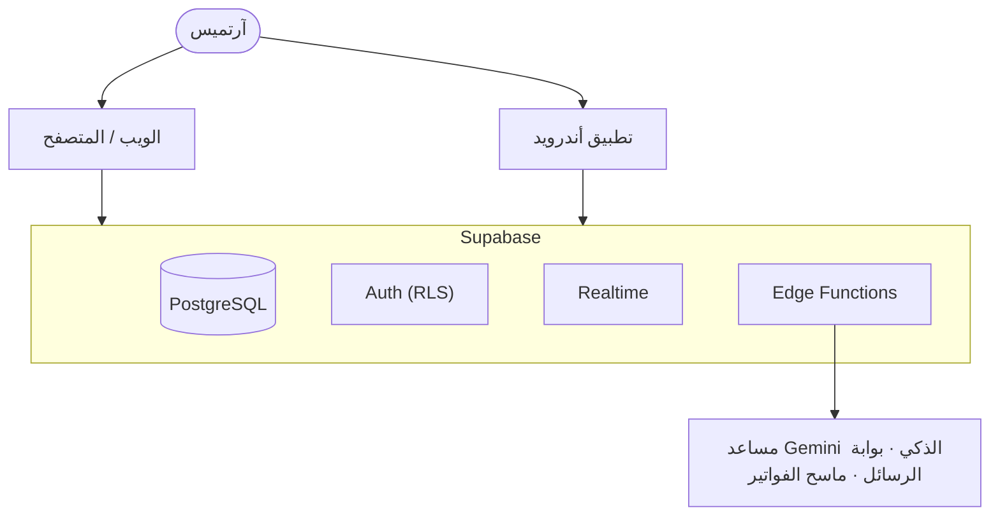

- **الواجهة الأمامية** — ملف واحد من HTML5/CSS3/JavaScript، دون خطوة بناء، متجاوبة وتدعم الكتابة من اليمين لليسار.
- **الخادم الخلفي** — Supabase: PostgreSQL، Auth، Realtime، Edge Functions، Row Level Security.
- **الجوال** — تطبيق أندرويد مُغلّف بـ Capacitor مع واجهات برمجة أجهزة أصلية.
- **الذكاء الاصطناعي** — Google Gemini عبر دالة Edge Function مخصصة، بالإضافة إلى منطق النوايا المحلي/التوقع الموضح أعلاه.
- **الأتمتة** — GitHub Actions لعمليات بناء أندرويد.

---

## العمل دون اتصال والمزامنة

يمكن الاستمرار في تسجيل المبيعات عند انقطاع الاتصال. تُحفظ المبيعات المعلّقة في طابور محلي مُعرَّف بمعرّف يُنشئه العميل؛ وعند عودة الاتصال، تتم مزامنة الطابور استنادًا إلى ذلك المعرّف بحيث لا يؤدي انقطاع الاتصال أثناء المزامنة إلى إنشاء نفس الفاتورة مرتين.

---

## الأمان والتفويض

- مصادقة Supabase وRow Level Security (RLS) في PostgreSQL
- قواعد وصول قائمة على الأدوار (مدير مقابل موظف)
- رمز وصول منفصل يحمي استعلامات المساعد الحساسة (المبيعات، الأرباح، المخزون، البيانات المالية)
- دوال Edge Functions من جانب الخادم لاستدعاءات الذكاء الاصطناعي، وإرسال الرسائل، ومسح الفواتير، بحيث لا تصل بيانات اعتماد المزوّدين إلى العميل أبدًا

> [!WARNING]
> **قبل النشر:** أعدّ مشروع Supabase الخاص بك. لا تقم أبدًا بحفظ مفاتيح service-role، أو كلمات المرور، أو مفاتيح API الخاصة، أو بيانات إنتاج/عملاء حقيقية في مستودع عام.

---

## لقطات الشاشة

الصور بالحجم الكامل موجودة في [`docs/screenshots/`](docs/screenshots/).

| | |
|---|---|
| **نقطة البيع / المبيعات**<br>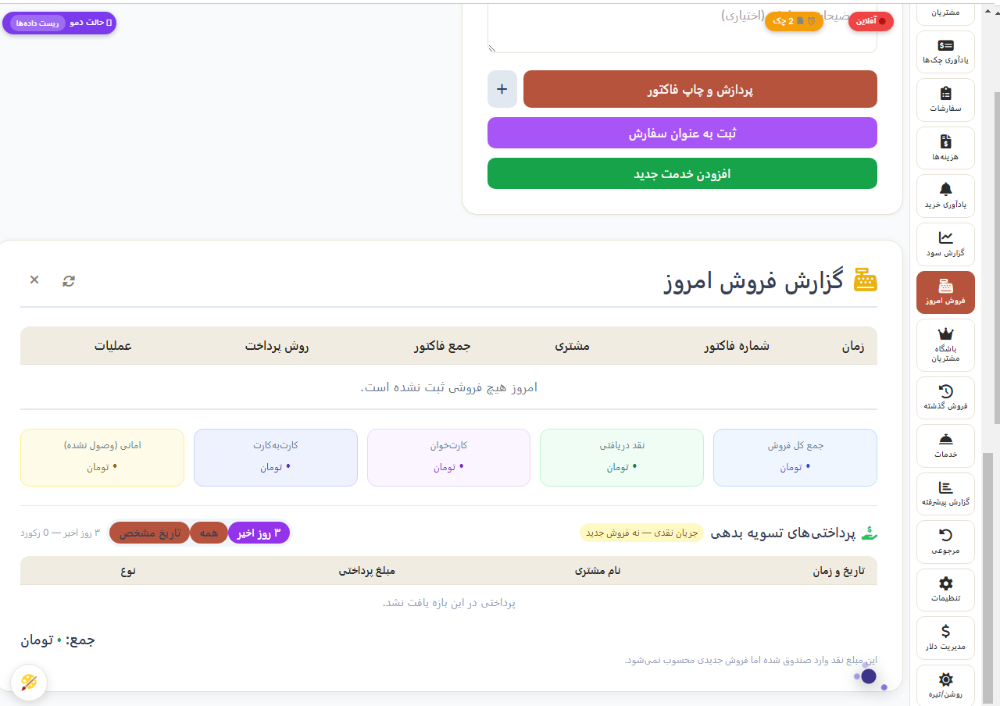 | **المخزون**<br>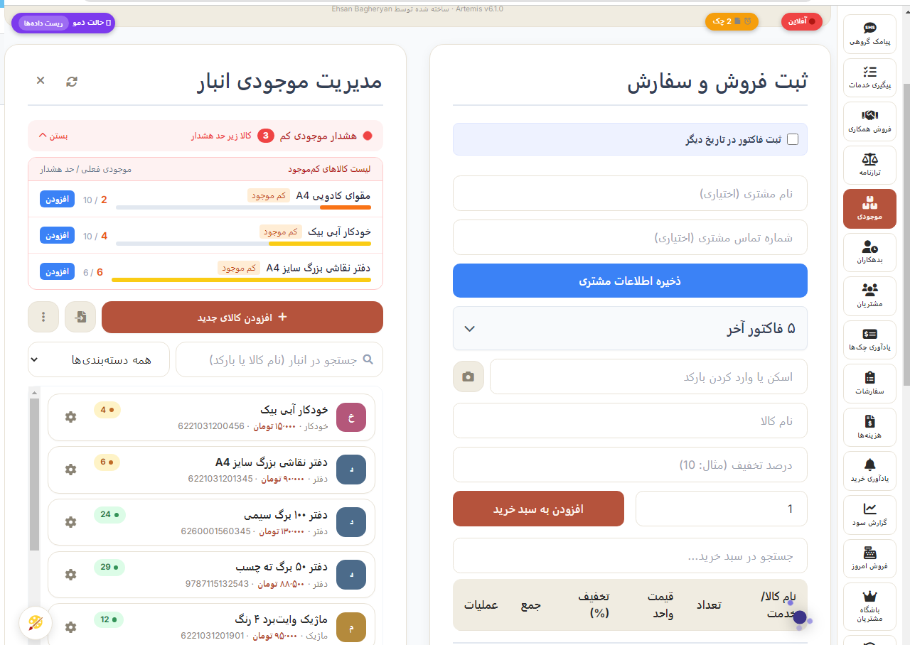 |
| **المرتجعات والاستبدال**<br>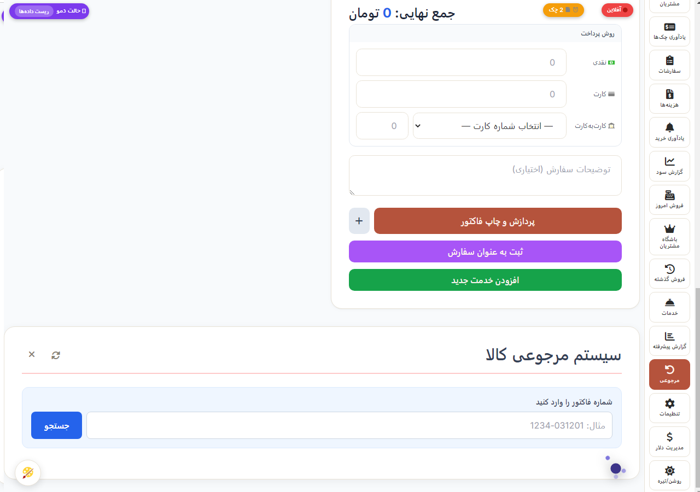 | **العملاء والولاء**<br> |
| **التقارير والميزانية العمومية**<br>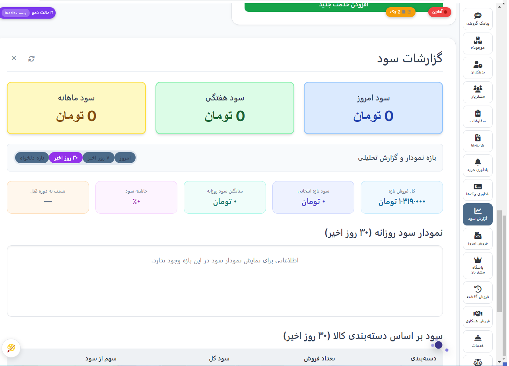 | **الإعدادات**<br>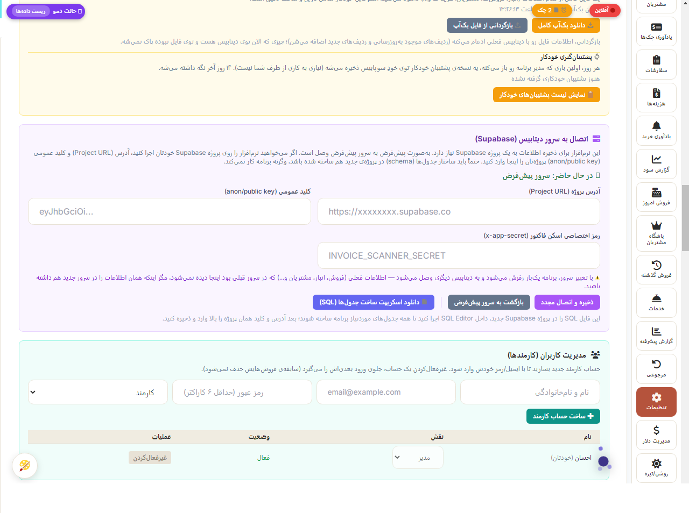 |
| **المساعد الذكي**<br> | **تطبيق أندرويد**<br> |

**المزيد من لقطات الشاشة**

| | | |
|---|---|---|
| **نادي العملاء**<br>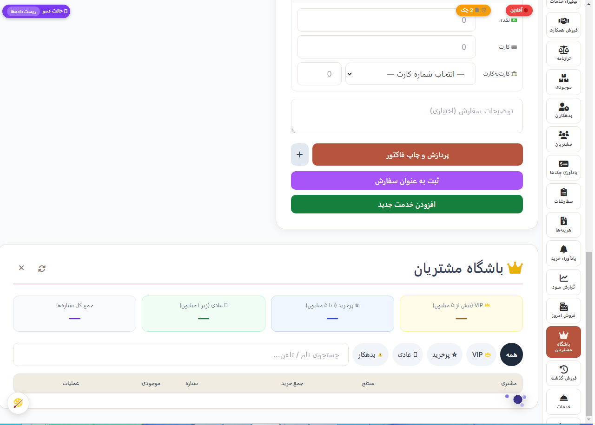 | **العملاء**<br>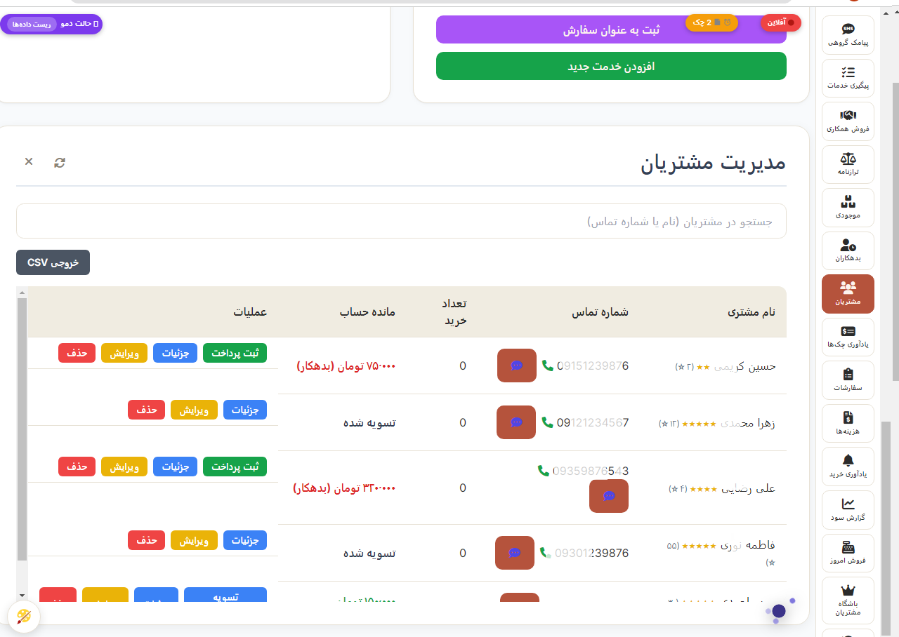 | **الإعدادات (الطباعة وغيرها)**<br>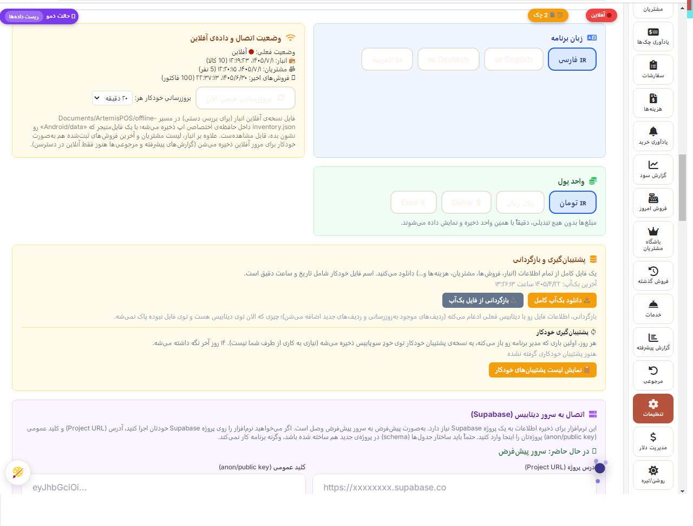 |

---

## البدء

يستخدم آرتميس مشروع Supabase الخاص بك للتخزين — أنت تملك بياناتك بالكامل.

1. أنشئ مشروع [Supabase](https://supabase.com) مجانيًا.
2. افتح `index.html` في متصفح — ستظهر لك شاشة الإعداد الأولي.
3. في محرر SQL الخاص بمشروع Supabase، شغّل سكربت إنشاء الجداول (يمكن للتطبيق توليده لك بعد الاتصال، من **الإعدادات ← تنزيل سكربت SQL**).
4. أدخل عنوان مشروع Supabase ومفتاح anon/public في شاشة الإعداد.

لا حاجة لأي خطوة بناء للواجهة الأمامية.

## بناء تطبيق أندرويد

تطبيق أندرويد مُعبّأ باستخدام [Capacitor](https://capacitorjs.com). راجع مجلد `android/` وworkflow الخاص بـ GitHub Actions تحت `.github/workflows/` لمعرفة آلية البناء. تشمل الإمكانات الأصلية مسح الباركود بالكاميرا، والمصادقة ببصمة الإصبع، والإشعارات المحلية، والطباعة الحرارية المباشرة عبر البلوتوث.

---

## أبرز الجوانب الهندسية

- تسوية الاستبدال التي توازن فرق السعر فقط، وليس معاملتين كاملتين متعاكستين
- طابور مبيعات دون اتصال بمعرّفات يُنشئها العميل لمنع الفواتير المكررة عند إعادة الاتصال
- معمارية مساعد ثلاثية الطبقات (نوايا محلية ← استعلام قاعدة بيانات مباشر ← ذكاء اصطناعي من جانب الخادم) بدلًا من توجيه كل رسالة عبر نموذج لغوي كبير
- توقع مبيعات بمعامل مناسبة مُتعلَّم ومرجَّح حسب الحداثة بدلًا من معامل ثابت مضبوط يدويًا
- Row Level Security وتحكم بالوصول قائم على الأدوار في كل مكان
- طبقات مزوّدين قابلة للتبديل للرسائل النصية والطباعة (دون ارتباط بمزوّد واحد في أي منهما)
- دعم كامل للكتابة من اليمين لليسار ولغات متعددة (الفارسية، الإنجليزية، الألمانية، العربية)
- تعبئة أندرويد عبر Capacitor مع تكامل أصلي مع الجهاز

---

## هيكل المستودع

```text
ArtemisPOSpublic/
├── index.html
├── docs/
│   └── screenshots/
├── README.md
├── README.fa.md
├── README.de.md
└── README.ar.md
```

هذا المستودع العام هو نسخة عرض توضيحي/محفظة أعمال تركّز على إظهار التطبيق ومعماريته.

## ملاحظة حول المستودع العام

> [!IMPORTANT]
> هذه نسخة عرض توضيحي عامة لنظام إنتاج خاص قيد الاستخدام الفعلي. لا يحتوي هذا المستودع — ويجب ألا يحتوي — على مفاتيح service-role، أو مفاتيح API خاصة، أو كلمات مرور، أو معلومات عملاء حقيقية، أو سجلات مالية حقيقية، أو أي بيانات اعتماد إنتاج أخرى. للنشر الفعلي، اربط آرتميس بمشروع Supabase الخاص بك.

---

## المطوّر

**إحسان باقريان** — مطوّر full-stack يركّز على تطبيقات الأعمال العملية، Supabase/PostgreSQL، سير العمل دون اتصال أولًا، وتكامل الذكاء الاصطناعي.

- البريد الإلكتروني: `bagheryane@gmail.com`
- GitHub: [@medad21](https://github.com/medad21)

## الترخيص

راجع ملف [LICENSE](LICENSE) لشروط الاستخدام.

</div>
